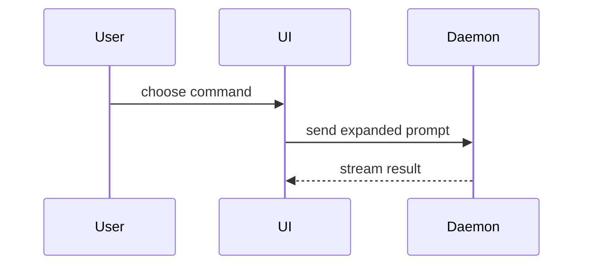

撰写 PR 正文时使用这个模板：

```markdown
## 概要

<图表、diff 草图或树>

## 证据

- **之前：** <截图/输出/失败的测试运行>
  **之后：** <截图/输出/通过的测试运行>

## 合并风险

**门：** <单向门或双向门>

<可选：描述>

**影响半径：** <一个词的描述>

<可选：合并的潜在连锁影响>
```

## 小节

跳过所有前言，行文保持简短。使用 `GLOSSARY.md` 里用户的领域语言。

### 概要

挑选能让关键点清晰的最小视图。

- 把逻辑或算法展示为伪代码：

```text
on(save)
  if content is unchanged
    return cached result
  write new content
  return fresh result
```

- 把运行时控制流展示为调用树：

```text
submitForm
  createSession
    persistPrompt
    launchAgent
  navigateToSession
```

- 把 UI 结构展示为组件树，包含要紧的状态和模块边界：

```text
<SessionPage> (apps/example/src/routes/session.tsx)
  useSessionEvents()
  <SessionToolbar>
    <RunSkillButton> (packages/ui)
```

- 把文件职责或大范围重构展示为浅层文件树：

```text
src/
├── commands/       # parses user actions
├── sessions/       # owns session state
└── transport/      # sends API requests
```

- 用 Mermaid 展示组件交互、控制流或数据流：



- 当重点是改变了什么、而周围形态已经存在时，用 `diff`。让 diff 的形态匹配主题。

针对组件改动：

```diff
 <SessionPage>
   useSessionEvents()
   <SessionToolbar>
+    <RunSkillButton />
   <SessionTimeline>
+    <SkillResultCard />
```

针对文件布局改动：

```diff
 src/
 ├── commands/
+│   └── show-me.ts       # expands the slash command
 ├── sessions/
-└── transport.ts
+└── transport/
+    ├── client.ts
+    └── stream.ts
```

针对调用树或调用栈改动：

```diff
 submitForm
   createSession
     persistPrompt
+    expandSkillMention
     launchAgent
-  navigateToSession
+  navigateToSession
+    subscribeToEvents
```

针对状态或控制流改动：

```diff
 on(save)
-  write content
+  if content is unchanged
+    return cached result
+  write new content
+  invalidate cache
```

- 当大部分内容都是新的、省略上下文会掩盖归属或顺序，或用户需要一个可复制过去的目标形态时，展示整个代码块：

```ts
function expandSkill(command: string): string {
  const skillName = command.slice(1);
  return `use the ${skillName} skill`;
}
```

#### 指引

把每个视觉元素放在它所支撑的简短文字旁边。只保留回答用户当前问题所需的调用、文件、props、状态和边界，或解决当前讨论点所需的选项。

你可以用其中之一，也可以用几个，但不太可能全都用上。用你的判断力，不要淹没用户。

### 证据

改动确实有效的具体证据。展示之前和之后。

截图是 S 级——前提是环境已经为它准备好，而且改动是视觉性的。

基于执行的证据是 A 级。测试结果、控制台输出。用伪代码展示那个现在先失败、随后通过的确切测试。

### 合并风险

描述这是单向门还是双向门。双向门可以走回去，单向门不行。回滚成本低的 PR 风险更低。涉及破坏性操作或难以逆转的决策的改动都是单向门。

影响半径是此 PR 引入的改动的潜在影响或波及范围。考虑所有可能性。例如布局偏移、使用方受损、移动端响应式等。
